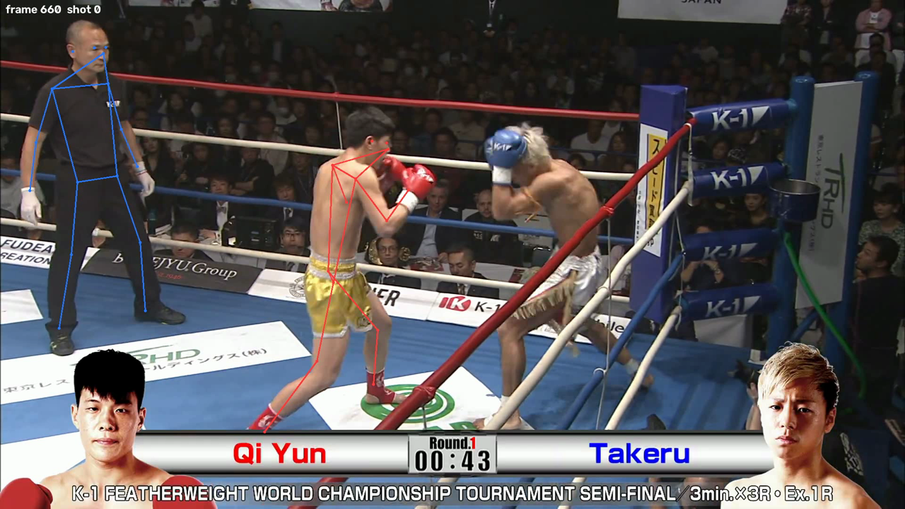
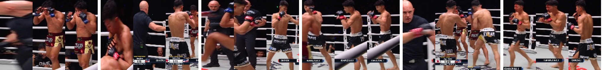
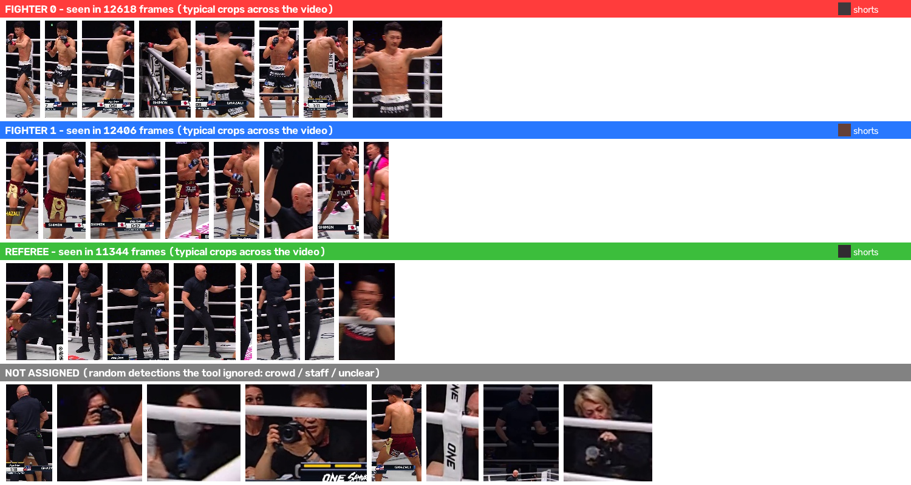
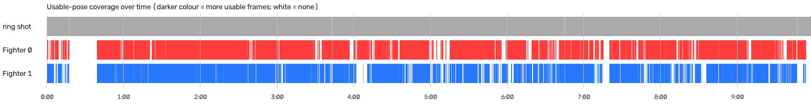
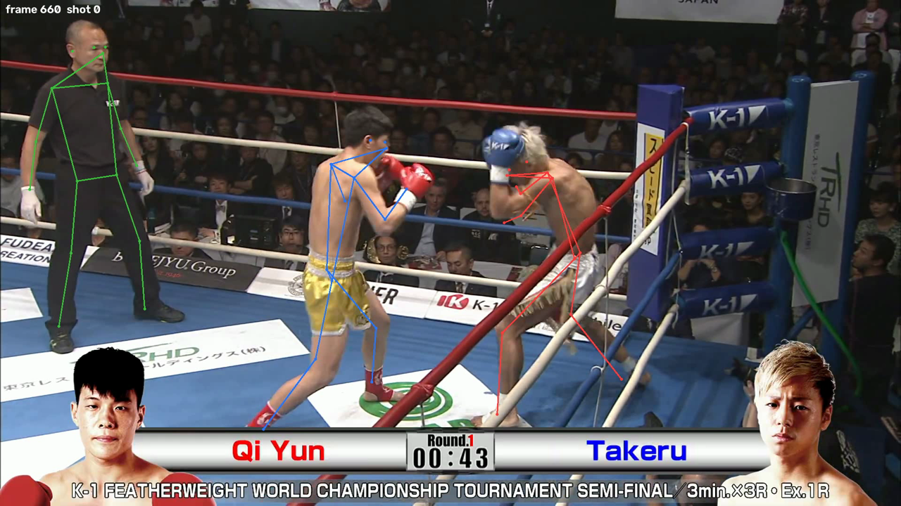

# K1 Score - Daily Report

**Project:** automatic scoring of K-1 kickboxing fights with computer vision
**Date:** 2026-11-16 (day 1)
**Status at end of day:** data-preparation tool (ingest) finished and tested on real fights; labeling tool and scoring model not started

---

## 1. Summary

Day 1 started from an idea and ended with a working first tool. The project was planned, the tool **ingest** (YouTube video to skeleton dataset) was designed, built and tested on two real fights, and a serious identity problem found in review (referee taking a fighter's place, fighters swapping numbers) was fixed.

Key result on the 10-minute Muay Thai test video: both fighters have a usable skeleton in **72%** of frames (30% at the start of the day), the referee is tracked separately, and fighter 0 / fighter 1 no longer swap. The automated tests grew from 13 to 21, all passing.

**Not started:** labels (hit / block / miss), the labeling tool, the scoring model.

---

## 2. Goal of the day

Start the project: plan it, build the first tool, and check on real video that the skeleton data is good enough to build on.

---

## 3. Work done

**Planning.** The project plan was written (`ARCHITECTURE.md`): a pose model supplies skeletons, OpenCV reads and draws video, a labeled dataset is built from web videos, and a PyTorch sequence model classifies each strike as hit, blocked or miss.

**Design.** The first tool was designed together with a folder structure for many tools (one shared core, one folder per tool) and a dataset format that stores raw facts (joint positions) instead of derived features, so the model can change later without re-processing videos.

**Implementation.** Tool 01 was built: download (YouTube, playlists, local files), video check, camera-cut detection, pose and tracking on the GPU, fighter selection, quality mask, validated export, a resumable pipeline and a command-line interface (`k1 ingest ...`).

**Real-video tests.** A 60-second K-1 clip and a 10-minute Muay Thai fight (14,943 frames) were processed. At about 25 frames per second the full fight takes about 10 minutes.

**Inspection tools.** A skeleton video, a preview page (typical frames, problem frames, coverage timeline) and an interactive frame-by-frame viewer were added so quality can be judged by eye, not only by numbers.

**Identities.** After review, a new stage tells the two fighters and the referee apart by appearance (dataset version 1.1.0 with a separate referee array, plus a command to swap fighter 0 and 1).

**Documentation.** The project report (`report/REPORT.md` and one file per stage) and this daily-reports folder were created.

---

## 4. Problems found and how they were solved

**A TV graphic counted as a fighter.** Broadcasts show a static portrait photo of each fighter in the corners; the pose model detects those faces as people, and one was chosen as fighter 1. Solution: ignore people who hardly move and people too small to be fighters. On the test clip usable frames for both fighters rose from 7% to 77%.

**Referee in a fighter slot, fighters swapping numbers.** Slots were filled by size and numbered left/right per shot.

First attempts that described whole *tracks* by clothing failed, because the tracker jumps between people in clinches: one track contained a referee, then one fighter, then the other.

Solution: decide identity for every person in every frame from appearance (bare torso versus dark shirt, shorts colour), learn the roles once per video, and give each role to at most one person per frame. A verification picture shows typical crops of each role.

**A wrong explanation, corrected.** Early in the day the missing second fighter was blamed on the pose model. Comparing old and new output for the same frame showed he had been detected all along and the selection rule had given his slot to the referee. Rule adopted: check raw detections before blaming the model.

**Silent empty data.** A test clip stored in a temporary folder was deleted and the pipeline produced an empty dataset without any error. Now a missing video stops the stage with a clear message, and a test covers it.

---

## 5. Results

10-minute Muay Thai test video (14,943 frames):

| Item | Start of day | End of day |
|---|---|---|
| Both fighters usable at once | 30% | **72%** |
| Fighter 0 usable (frames) | 10,685 | 12,520 |
| Fighter 1 usable (frames) | 6,095 | 12,243 |
| Referee | mixed into fighter slots | separate, 11,344 frames |
| Fighter 0/1 swap between shots | yes | no |
| Automated tests | 13 | 21 (all passing) |

On the 60-second K-1 clip, usable frames for both fighters rose from 77% to 85%, and the frame that showed the referee in a fighter slot is now correct:

---

## 6. Known limits at end of day

- A stray person in black (for example a photographer) can take the referee role when the real referee is not detected.
- After the fight, extra people in the ring can be labelled as a fighter.
- The method needs visibly different shorts and a shirted referee.
- A fighter hidden behind the other has no skeleton in those frames.
- Settings were tuned on two videos only.

---

## 7. Not done

- No labels, labeling tool or scoring model.
- The 9-minute K-1 fight (Qi Yun vs Takeru) was downloaded but not processed.

---

## 8. Plan for the next day

1. Try a larger pose model and accept frames with fewer visible joints; compare coverage.
2. Process 3-5 more fights to check that the identity method generalises.
3. Start tool 02: automatic strike candidates and the labeling viewer.

---

## 9. Files changed or added

`ARCHITECTURE.md`, `README.md`, `pyproject.toml`, `configs/ingest.yaml`; `src/k1score/core/*`, `src/k1score/cli.py`, `src/k1score/tools/ingest/*` (including `identify.py`, `tracks.py`, `preview.py`); `tests/*`; `docs/tools/01_ingest.md`; `report/*`; `daily_reports/*`.
