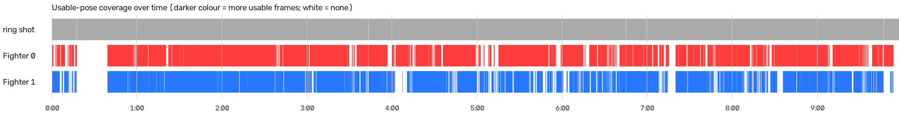

# K1 Score - Daily Report

**Project:** automatic scoring of K-1 kickboxing fights with computer vision
**Date:** 2026-11-17 (day 2)
**Status at end of day:** stage 1 (video to skeleton data) unchanged and working; stages 2 and 3 designed on paper, nothing built yet

---

## 1. Summary

Day 2 was a planning and research day, no new code. The project was put on GitHub, the question "can we reuse existing datasets?" was researched, and the whole scoring system was designed as a **3-stage pipeline** with written data schemas.

Main finding: no public dataset with **hit / blocked / miss** labels for kickboxing was found. The closest dataset (BoxingVI) covers boxing punch types only. So the outcome labels have to be created by the project itself, with automatic first guesses and a small human-verified set.

---

## 2. Goal of the day

Decide how to get from skeleton data to a fight score: what data can be reused, what the model must output, and how points and a winner are calculated.

---

## 3. Work done

**Repository.** The first commit (tool 01, report, daily reports) was pushed to GitHub, so the report can be linked from the LinkedIn post.

**Dataset research.** Public datasets for combat-sport strikes were searched (one search per topic, licences not yet checked).

| Dataset | What it offers | Limit for us |
|---|---|---|
| BoxingVI | about 6,900 punch clips from 20 YouTube videos, 2D skeletons | boxing only; no kicks; no hit/block labels; sparring footage, not fights |
| BoxMAC | pro-bout clips with block / guard labels | download not confirmed; no skeletons |
| MMA pose dataset (UFC) | 5,109 images with 17 keypoints per fighter | pose only; could help improve skeleton quality |
| Kickboxing strike trajectories | about 4,000 trajectories on a bag | no opponent, no outcome |

**Design questions.** Four decisions were taken with the user: K-1 scoring rules (as a configurable file), one record per strike plus a per-frame lookup table, BoxingVI plus own automatic outcome labels, and strike types punches, kicks and knees.

**K-1 rules check.** Sources support 3-round bouts and the 10-point must system. Knockdown scoring (10-8) and the extra-round procedure came from other promotions, so they must be verified against the official K-1 rulebook before use.

**Pipeline plan** (`docs/pipeline_v1_scoring.md`):
1. Stage 1 (built): video to skeleton frames.
2. Stage 2: skeleton frames to a list of strikes: when, who, type, hit / blocked / miss, confidence.
3. Stage 3: strikes plus scoring config to points per round, round scores and a decision.

The plan includes the exact columns of the strike table and the per-frame table, the scoring config, open problems and six milestones.

---

## 4. Problems found and how they were handled

**No labelled data for the core task.** Solution in the plan: the system finds strikes automatically from limb movement, gives a first guess for hit / block / miss (limb distance to head and body, opponent's guard, opponent's reaction, possibly impact sound), and a human checks a small set from fights not used for training. Without that checked set the model's real accuracy cannot be known.

**A fact corrected.** A search summary said BoxingVI has six punch types, another named four. The plan now says "check the paper" instead of stating a number.

**Per-frame labels do not fit strikes.** A strike spans 10-30 frames, so labelling each frame would cause double counting in scoring. Decision: score from strike records, keep the per-frame table only for display.

---

## 5. Results

| Item | Value |
|---|---|
| New code | none (planning day) |
| Tests | 21, all passing |
| New documents | `docs/pipeline_v1_scoring.md`, this report |
| GitHub | first commit pushed |
| Skeleton coverage (unchanged) | both fighters usable in 72% of frames on the 10-minute test fight |

---

## 6. Known limits at end of day

- Round boundaries, knockdowns and fouls cannot be found from strikes alone (manual input in version 1).
- Hit versus block may not separate from a 2D skeleton; image crops are the fallback.
- Dataset licences are not checked yet.
- Point weights and the 10-8 rule in the scoring config are placeholders, not official values.

---

## 7. Not done

- No strike finder, no model, no scoring code.
- BoxingVI licence, download and keypoint format not checked.
- The 9-minute K-1 fight is still only downloaded.

---

## 8. Plan for the next day

1. Milestone M1: automatic strike finder and the strike table, checked on the two processed fights.
2. Check the BoxingVI licence and format.
3. Verify the K-1 rules against the official rulebook.

---

## 9. Files changed or added

`docs/pipeline_v1_scoring.md`, `daily_reports/2026-11-17.md`, `report/linkedin_post.md`.
