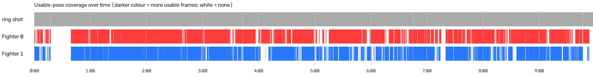

# K1 Score - project report

Goal: a model that watches a K-1 / kickboxing fight and decides for every strike whether it was a **hit**, **blocked**, or a **miss**, so that rounds can be scored automatically.

This folder documents everything done so far, stage by stage (state on 2026-11-16).

| Stage | Document | What happened | Status |
|---|---|---|---|
| 0 | [Goal and plan](stage_0_goal_and_plan.md) | Idea, requirements, architecture plan | done |
| 1 | [Tool 01 design](stage_1_tool_design.md) | Folder structure, dataset contract, pipeline design | done |
| 2 | [Implementation v0.1](stage_2_implementation_v01.md) | Code for the `ingest` tool, tests | done |
| 3 | [First real-video tests](stage_3_first_real_tests.md) | Real download + pose run, first bugs found and fixed | done |
| 4 | [Full Muay Thai video](stage_4_muaythai_full_video.md) | 10-minute test, human-readable previews, viewers | done |
| 5 | [Identities v0.2](stage_5_identities.md) | Fighters and referee told apart, stable for the whole video | done |
| 6 | [Current state and next steps](stage_6_state_and_next.md) | Numbers, limits, what comes next | - |
| 7 | [Model v0.0.1](stage_7_model_v001.md) | Rule-based strikes, outcome and scoring baseline (2026-11-18) | done |

**Start with [REPORT.md](REPORT.md)**: the whole project as one continuous text report. The stage files in the table above give the same story in more detail, one per stage.

## Where we are in one paragraph

Tool 01 (`ingest`) turns a YouTube URL into a clean **pose dataset**: per frame, the skeletons of fighter 0, fighter 1 and the referee, with a quality mask. It runs end to end (download, shot detection, pose + tracking, identity, export), is resumable, has 21 automated tests, and was run on two real fights. **There is no scoring model yet**: the dataset has no labels (hit / blocked / miss), and the labeling tool (tool 02) and the model (tool 03) are not built.

## Headline numbers (10-minute Muay Thai test video)

| Metric | v0.1 (first version) | v0.2 (with identities) |
|---|---|---|
| Frames where **both** fighters are usable | 30% | **72%** |
| Frames usable, fighter 0 / fighter 1 | 10,685 / 6,095 | **12,520 / 12,243** |
| Referee tracked separately | no (could fill a fighter slot) | **yes, 11,344 frames** |
| Fighter 0/1 swap between shots | yes | **no** (decided by appearance) |



## Run it yourself

```bash
cd ~/Documents/code/CV/K1_SCRORE && source .venv/bin/activate
k1 ingest add "https://www.youtube.com/watch?v=<id>" --run   # download + full pipeline (~10 min per 10-min video)
k1 ingest preview <id>        # pictures + who-is-who sheet + coverage timeline
xdg-open data/interim/<id>/preview/index.html
k1 ingest view <id>           # interactive frame-by-frame viewer
k1 ingest status              # state of every video and stage
pytest                        # 21 tests, no GPU or network needed
```

## Related files outside this folder

- `ARCHITECTURE.md` - the full project plan (stage 0)
- `docs/tools/01_ingest.md` - detailed design and implementation notes of tool 01
- `README.md` - quickstart
- `configs/ingest.yaml` - settings for tool 01
