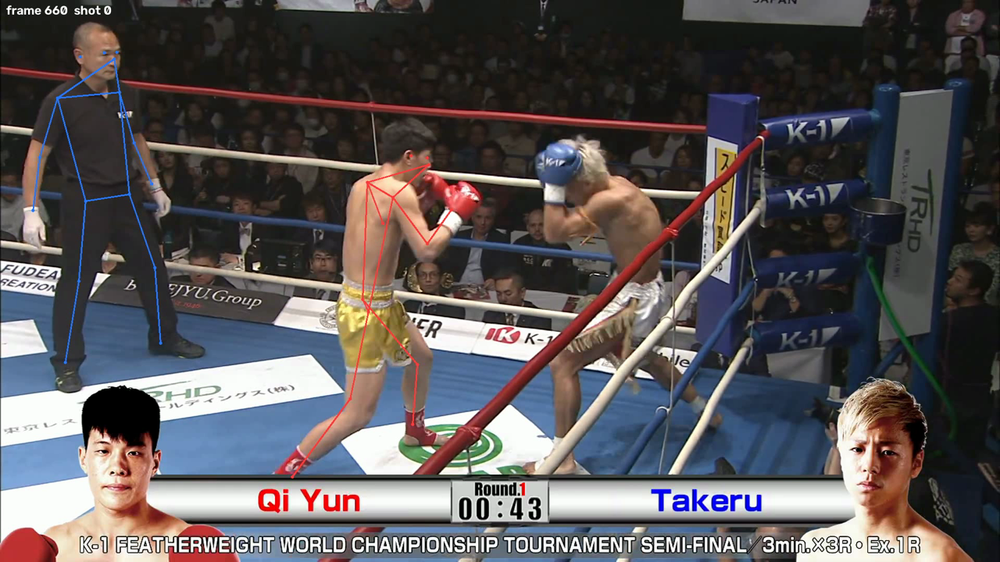
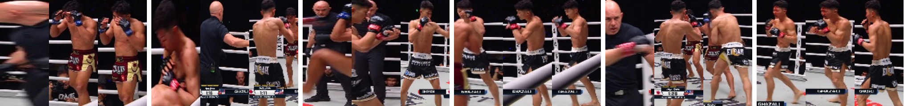
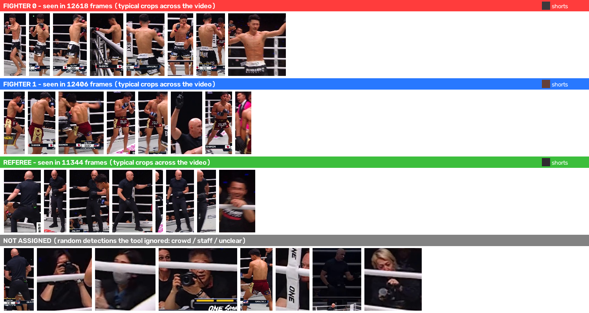
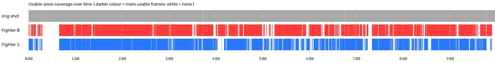
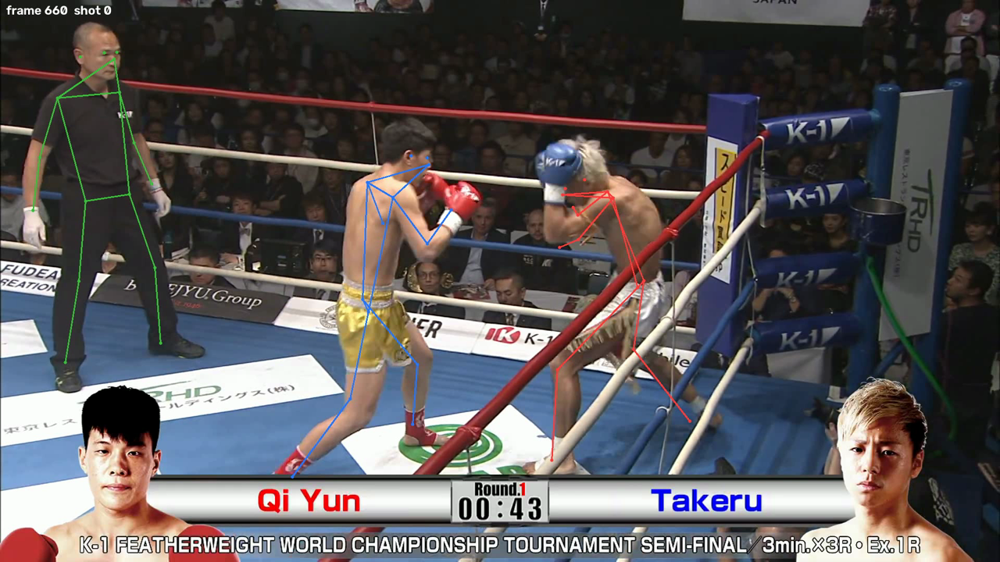
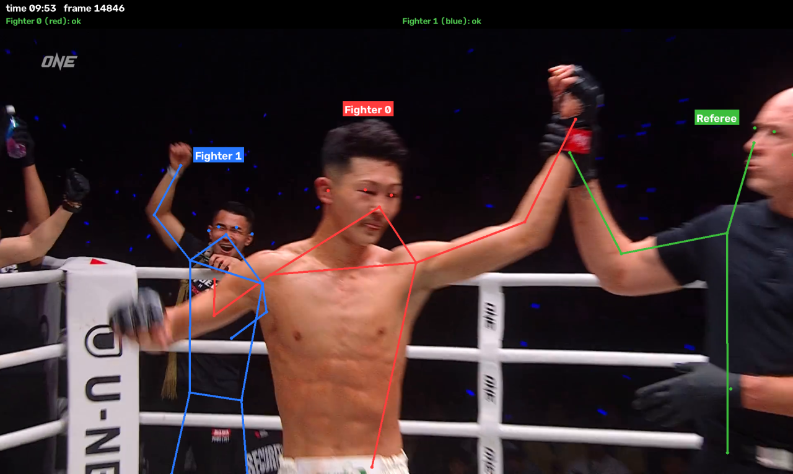

# K1 Score - Project Report

**Project:** automatic scoring of K-1 kickboxing fights with computer vision
**Date of this report:** 2026-11-16
**Status:** data-preparation tool finished and tested on real fights; labeling tool and scoring model not started

---

## 1. Summary

The goal of the project is a model that watches a kickboxing fight and decides, for every strike, whether it was a **hit**, a **block**, or a **miss**, so that rounds can be scored automatically.

The work so far built the first tool of the project, called **ingest**. It takes a YouTube link and produces a clean dataset of **body skeletons** for the two fighters and the referee, frame by frame, with a quality indicator. It was run on two real fights and has 21 automated tests, all passing.

**What does not exist yet:** labels (which strikes were hits, blocks or misses), the labeling tool, and the scoring model itself. These come next, and the dataset built so far is the foundation for them.

Key result on a 10-minute Muay Thai test video: both fighters have a usable skeleton in **72%** of the frames (30% in the first version), the referee is tracked separately, and fighter 0 / fighter 1 never swap places.

---

## 2. Starting idea and plan

The request: use OpenCV to extract a skeleton from fight video frames, build a labeled dataset from videos found on the web, and train a PyTorch classification model on the skeleton points (arms, legs and so on) that decides whether a strike was a hit, blocked, or a miss.

Decisions taken in the plan (full text in `ARCHITECTURE.md`):

- OpenCV alone cannot produce skeletons, so it is used for reading video and drawing, and a **pose model** (YOLO-pose) supplies the joints. A single-person model was rejected because two fighters often overlap.
- Four classes: hit, blocked, miss, and "no strike".
- The model works on **sequences** of skeletons over about a second: a 1D-CNN plus a bidirectional GRU (this is the "at least 4 layers" model), compared against a simple baseline, a small Transformer and a graph network.
- Labeling is semi-automatic: the computer proposes strike moments from fast limb movement toward the opponent, and a person labels each with one key.
- Evaluation splits data by **fight**, never by random clips, to avoid leaking the same fight into both training and test data.
- Web videos are copyrighted, so raw videos stay private.

---

## 3. Design of the first tool

Because many tools will follow, the project is organised as **one package with a shared core and one folder per tool** (ingest, label, train, infer). Tools never import each other; only the core knows where files live and how the dataset is read.

The central design rule is **"store facts, not features"**: the dataset keeps raw joint positions and metadata. Anything derived (normalization, speeds, time windows) is computed later in model code, so the model can change without re-processing any video.

The pipeline has stages, each resumable and recorded per video: download, probe (size and frame rate), shots (camera-cut detection, keeping only wide ring shots), pose, identify (added later, section 7), select, and export. The result is a dataset per video: for every frame, 17 joints for each of two fighters plus a quality flag and the shot number. Labels will live in a separate file that refers to frame ranges, so re-extracting poses never breaks them.

---

## 4. Implementation

The tool was implemented with Python 3.13, a `uv` virtual environment, Ultralytics YOLO11 pose and tracking on the GPU (GTX 1650), yt-dlp for downloads, and OpenCV for video. Weights are stored in `models/`, data in `data/` (excluded from version control).

Features: download of single videos, playlists and local files; per-video status table; stages skip themselves when already done; redoing one stage invalidates the later ones; every dataset is validated against a written schema before it is saved; all raw detections are kept so selection logic can be re-tuned in seconds without running the pose model again.

First test suite: 13 tests (synthetic video, fake pose model), all passing.

---

## 5. First tests on real video and the problems they revealed

The first real download worked (a 9-minute K-1 fight, 265 MB). A 60-second clip went through the whole pipeline at about 25 frames per second.

**Problem 1: a TV graphic was treated as a fighter.** Broadcasts show a static portrait photo of each fighter in the lower corners. The pose model detects those faces as people. They are present in every frame, so the "biggest people win" rule picked one as fighter 1. Fix: ignore people who hardly move and people who are too small. Usable frames for both fighters rose from 7% to 77% on that clip. Several refinements were needed (for example not removing a fighter who only moves along one axis).

**Problem 2: the referee took a fighter's slot.** After fix 1, the referee still received a fighter slot while the second fighter had no skeleton.



At the time this was explained as "the pose model does not see the second fighter". That explanation was **wrong**: later work showed he had been detected all along and the selection rule had given his slot to the referee. The lesson recorded: look at the raw detections before blaming the model.

---

## 6. Full 10-minute test and tools to inspect results

A 10-minute Muay Thai fight (Shimon vs Ghazali, 14,943 frames, 1080p) was processed in about 10 minutes. First version results: 22 camera shots found, 11 classified as ring shots covering practically the whole fight; fighter 0 usable in 72% of frames, fighter 1 in only 41%; both at once in **30%**.

Because "it ran" says nothing about quality, tools were added to look at the data: a skeleton video, a preview page (typical frames, problem frames, and a timeline showing when each fighter is usable), and an interactive frame-by-frame viewer.

The user's review of these pictures identified the two problems that drive the next stage: the referee must be separate from the fighters, and fighter 0/1 must not swap.

---

## 7. Identifying fighters and referee (version 0.2)

**Cause.** Slots were filled by size and then numbered left/right per shot. A missed fighter let the referee in; every camera cut or side change could swap the numbers.

**Failed attempts.** Describing each *track* (colour of torso and shorts) and clustering the tracks gave mixed groups. The reason was found by looking at the pictures: a tracker identity is not one person. In clinches the tracker jumps between people, so a single track contained a blurred referee, then one fighter, then the other.



**Final solution: decide identity for every person in every frame, from appearance.**

1. Measure how much bare skin is on the torso and the colour of the shorts, using the skeleton to find the body regions.
2. Learn the roles once per video: the referee is the person with almost no bare skin (dark shirt); the fighters are two groups by shorts colour. Fighter 0 is always the one with the less saturated shorts, so repeated runs agree.
3. In every frame, give each role to at most one person (optimal assignment). Fighters must have a bare torso, the referee a shirt. Anyone who fits no role (crowd, photographers) is ignored.

A picture is produced to verify the assignment by eye: typical crops of each role across the whole video.



The dataset format gained a separate **referee** array (version 1.1.0; old datasets still load), and a command exists to swap fighter 0 and 1 (for example to match red/blue corner).

**Results**

| | first version | with identities |
|---|---|---|
| Both fighters usable at once | 30% | **72%** |
| Fighter 0 usable (frames) | 10,685 | 12,520 |
| Fighter 1 usable (frames) | 6,095 | 12,243 |
| Referee | mixed into fighter slots | separate, 11,344 frames |
| Fighter 0/1 swap between shots | yes | no |



On the 60-second K-1 clip the share rose from 77% to 85%, and the frame that earlier showed the referee in a fighter slot is now correct (referee green, one fighter blue, the other red):



Twelve sample frames from the Muay Thai fight: see `images/s5_contact_sheet_after_identity.png`.

**Bugs found on the way:** a missing library (scipy) was added; and a test clip stored in a temporary folder was later deleted, after which the pipeline silently produced empty data. Now it stops with a clear error, and a test covers it.

Test suite: 21 tests, all passing, including one where the fighters swap sides in the middle shot while fighter 0 must remain the same person.

---

## 8. Known limits

- A stray person in black (for example a photographer) can take the referee role when the real referee is not detected.
- After the fight, many people enter the ring and an extra person can be labelled as a fighter.



- The method needs visibly different shorts and a shirted referee; same-colour shorts would merge the fighters (the verification picture shows this).
- A fighter hidden behind the other has no skeleton in those frames.
- Fighter order follows shorts colour, not red/blue corner (a swap command exists).
- Settings were tuned on two videos only; every new video should be checked with the preview pictures.
- A 2D skeleton from one camera may not be enough to separate hit from block later; the original videos are kept so that image crops can be added.

---

## 9. Current state

| Item | State |
|---|---|
| Tool 01 `ingest` (video to skeleton dataset) | built, version 0.2 |
| Tool 02 labeling | not started |
| Tool 03 model training | not started |
| Tool 04 inference and scoring | not started |
| Code | about 1,800 lines in `src/`, about 400 lines of tests |
| Tests | 21, all passing |
| Videos processed | Muay Thai 10 min (both fighters usable 72%); K-1 clip 60 s (85%); a 9-minute K-1 fight downloaded but not processed |

---

## 10. Next steps

1. **Improve data quality:** accept frames with fewer visible joints (tight shots cut off the legs) and test a larger pose model; compare coverage.
2. **Process 3-5 more fights** in different arenas to check that the identity method generalises.
3. **Labeling tool:** automatic strike candidates, a viewer that plays each 1-2 second clip with skeletons and accepts a key (hit / blocked / miss / none), plus a written labeling guide.
4. **Baseline model, then the 1D-CNN + GRU model**, evaluated on fights not used for training (macro-F1 and confusion matrix).
5. **Inference and scoring rules** that turn detected strikes into round scores.
6. If hit and block cannot be separated from skeletons alone, add an image-crop branch.

---

## 11. How to run and view

```bash
cd ~/Documents/code/CV/K1_SCRORE && source .venv/bin/activate
k1 ingest add "https://youtu.be/sqrSVvNe8wY" --run     # download and process (about 10 min)
k1 ingest preview sqrSVvNe8wY                           # pictures
xdg-open data/interim/sqrSVvNe8wY/preview/index.html    # who-is-who sheet, frames, timeline
k1 ingest view sqrSVvNe8wY                              # interactive frame-by-frame viewer
pytest                                                  # 21 tests
```

More detail per stage: `stage_0_goal_and_plan.md` ... `stage_6_state_and_next.md` in this folder.
