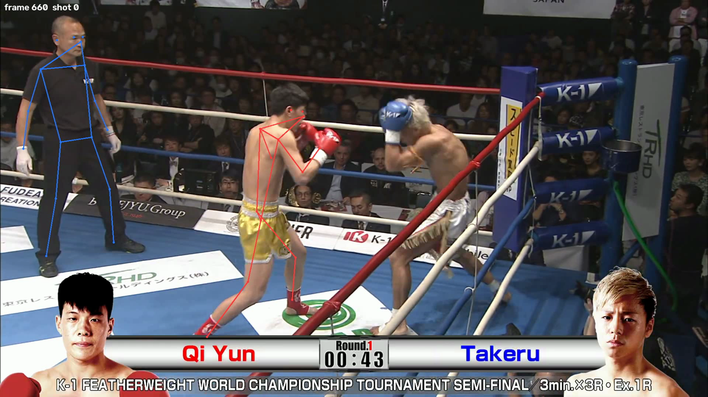

# Stage 3 - First real-video tests

## Step 1: YouTube download
`k1 ingest add "https://www.youtube.com/watch?v=Kn28vrUnT0k" --run` (Qi Yun vs Takeru, K-1, 9 min, 1080p, 265 MB) downloaded correctly. This video was **only downloaded**; it has not been processed.

Small fix: yt-dlp printed hundreds of progress lines, so `noprogress` was switched on.

## Step 2: full pipeline on a 60-second clip
A 60 s clip (1799 frames) was cut from that fight and run through every stage with the real pose model. It worked end to end (about 25 frames per second on the GTX 1650), but the first look at the result showed real problems.

### Problem 1 - a broadcast graphic was selected as a fighter
The TV broadcast shows a **static portrait photo of each fighter** in the bottom corners. The pose model detects those faces as people. They are present in every frame, so my "biggest tracks win" rule chose one of them as fighter 1 and ignored the real fighter.

Evidence from the track table: two tracks present in all 1799 frames whose box centre barely moved (vertical std 0.7 px) - the two portraits.

**Fix:** drop *static* tracks (almost no motion on one axis and little overall) and tracks too small to be a fighter. Result on that clip: usable frames for both fighters went from **7% to 77%**.

Refinements needed while testing the rule:
- first version used `min(std_x, std_y)` only, which wrongly removed fighters that move along a single axis -> now requires low motion on one axis **and** small motion overall;
- a track needed 60 detections (about 2 s) before it may be judged static, otherwise short fragments of a fighter who stood still were removed.

### Problem 2 - the referee takes a fighter's slot
After fixing problem 1, the same frame still looked wrong: the **referee** received fighter slot 1, while the second fighter had no skeleton.

*Blue = fighter slot 1, but it sits on the referee (left); the fighter on the right (Takeru) has no skeleton.*

I first explained this as "the pose model does not detect Takeru". **That was wrong.** Once identities were added (stage 5), the same frame shows Takeru detected. He had been detected all along; the old selection rule simply gave his slot to the referee. Lesson: when a result looks wrong, look at the raw detections before blaming the model.

This problem was left open and solved properly in stage 5.

## Other things fixed in this stage
- model weights were downloaded into the working directory -> now stored in `models/`
- relinking of fragmented tracks: switched to "closest pair first" so a nearby referee cannot steal a slot from the fighter's own new track id
- test fixtures used perfectly still boxes, which the new static filter (correctly) rejected -> fixtures now move like real people
- known limit written into the code: if a fighter's track fragments evenly, the start of the shot can stay empty

Tests after this stage: 14 passed.
