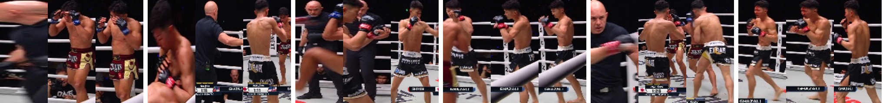
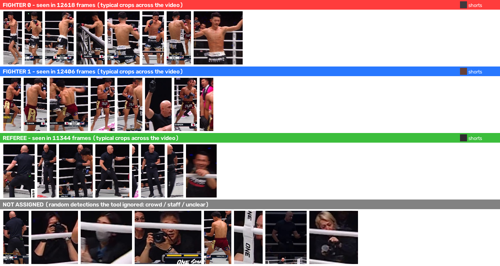
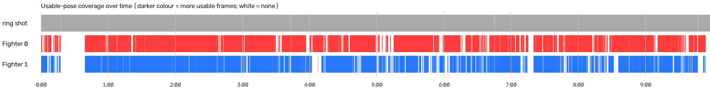
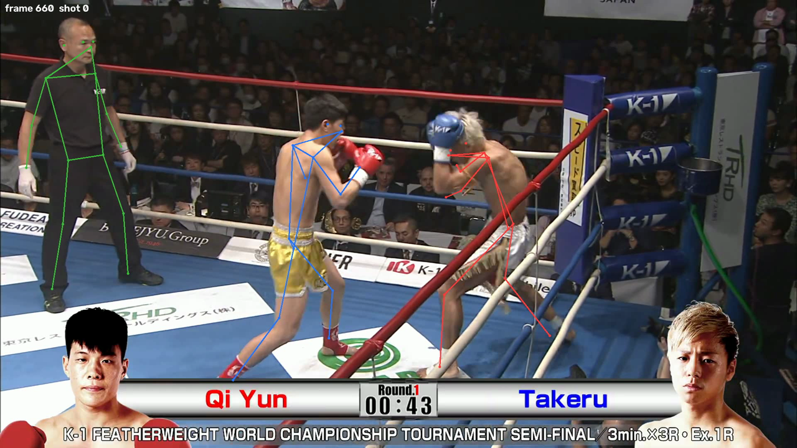
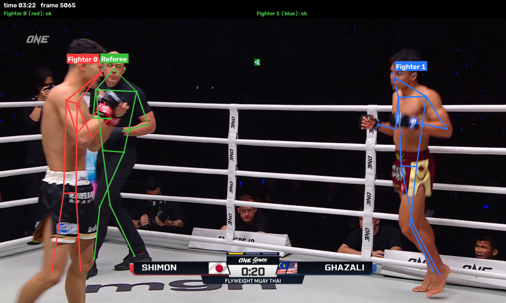

# Stage 5 - Identities: fighters and referee told apart (v0.2)

## Request
"Define fighters and referee separately, and do not change fighters 0 <-> 1."

## Why it happened
- Slots were filled by "the two biggest tracks", numbered left/right at the start of each shot.
- If a fighter was missed, the referee (also a big person) filled the slot.
- Whenever the fighters switched sides or the camera cut, slot 0 and 1 swapped.

## Attempts and what each taught

| Attempt | Idea | Outcome |
|---|---|---|
| A | Describe each **track** with a colour histogram of torso + shorts, cluster tracks into 3 groups | Wrong: the groups mixed people |
| B | Same, but a simpler two-step rule (referee = shirt, fighters = shorts colour) | Data showed a clean split by **bare skin** (referee ~0.1-0.3, fighters ~0.6-0.85) and shorts colour, but results were still mixed |
| **C (final)** | Decide identity **per detection, per frame**, not per track | Works |

### The key discovery (why A and B failed)
A tracker id is **not** one person. In clinches ByteTrack jumps between people, so a single track contains several. The picture below shows crops from the *first three frames* of the largest "fighter 0" tracks: one track contains a blurred referee, then a fighter in maroon shorts, then the fighter in black shorts.

So any method that decides "this track is fighter 0" is wrong by construction. Identity must be decided for every detection.

## Final design (stage `identify`)
1. **Measure appearance** of every detection from the pose keypoints: torso region (share of bare skin, darkness) and shorts region (colour, saturation, darkness). Smooth along the track with a short rolling median to remove occlusion noise.
2. **Learn the roles once per video** (2-means): referee = the shirted cluster (little skin), fighters = two clusters by shorts colour. `fighter_0` is always the fighter with the less saturated shorts, so re-runs agree.
3. **Per frame, assign detections to roles** with the Hungarian algorithm: each role is used at most once per frame; fighters need a bare torso and the referee a shirt; a detection that fits no role stays `other` (crowd, photographers, graphics).

Outputs: `identities.npz/json` (role of every detection), `identity_crops/`, and `identity_sheet.png` to verify by eye (shown on top of `preview/index.html`). If the order is wrong (for example to match red/blue corner): `k1 ingest identify <id> --swap`.

*Each row shows typical crops the tool assigned to that role across the whole video. Fighter 0 = black shorts, fighter 1 = red/gold shorts, referee = black shirt. The last row is what was ignored (photographers, crowd, unclear).*

## Dataset change (schema 1.0.0 -> 1.1.0, backward compatible)
- new optional array `referee` (N, 17, 3)
- `meta.json` gets `identities` (shorts colour per role, `swapped` flag) and `referee_frames`
- old 1.0 datasets still load

## Results

10-minute Muay Thai video:

| | v0.1 | v0.2 |
|---|---|---|
| Both fighters usable at once | 30% | **72%** |
| Fighter 0 usable (frames) | 10,685 | **12,520** |
| Fighter 1 usable (frames) | 6,095 | **12,243** |
| Referee | mixed into fighter slots | **separate, 11,344 frames** |
| Fighter 0/1 swaps | yes | no |

60-second K-1 clip (Qi Yun vs Takeru), usable for both fighters 77% -> 85%. The frame that showed the referee in a fighter slot in stage 3, now:

*Referee green (left), Qi Yun blue, Takeru red - Takeru is now correctly detected.*

A clinch with the referee close by:

Overview of 12 sample frames (9 typical, 3 problem examples): [s5_contact_sheet_after_identity.png](images/s5_contact_sheet_after_identity.png)

## Bugs found on the way
- `scipy` was assumed to come with ultralytics, but was missing -> added to dependencies.
- The 60-second test clip was stored as a link into a temporary folder that was later cleaned. The pipeline then silently produced **empty data** instead of failing. Now every stage that needs the video fails with a clear error ("video file missing ..."), and a regression test covers it. The clip was re-cut into `data/clips/`.

## Tests
21 passed: appearance measurement on painted synthetic people, role learning, one-role-per-frame and clothing gate, missing referee, static-overlay rule, per-detection selection, and an end-to-end run where the fighters **swap sides** in the middle shot while fighter 0 must stay the same person and the referee must stay separate.
