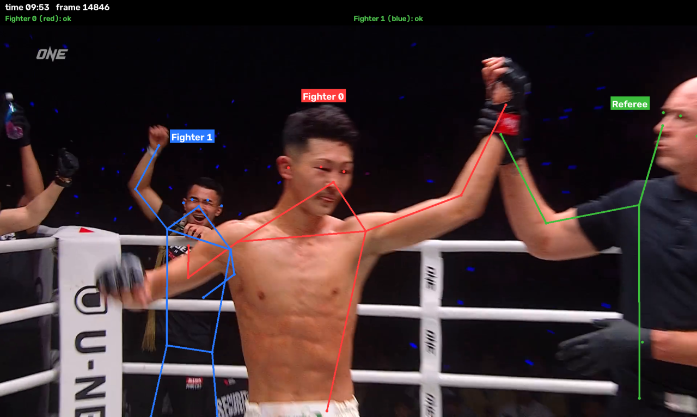
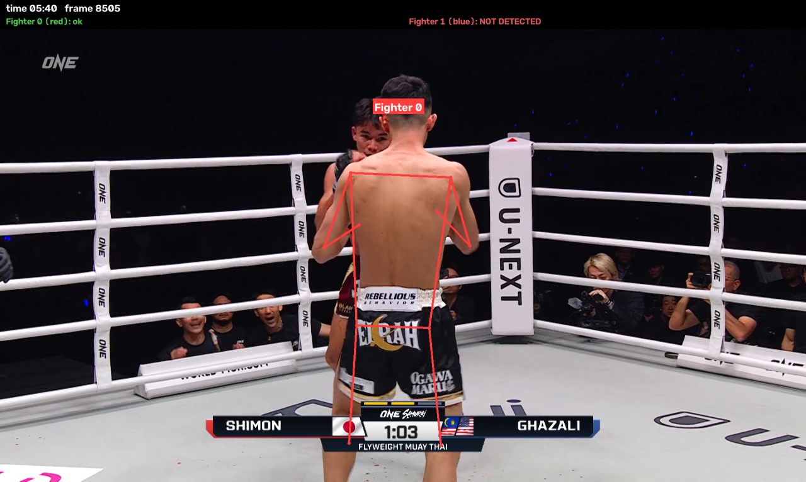

# Stage 6 - Current state, known limits and next steps

## What exists today

```
Tool 01 ingest   [built, v0.2]   YouTube video -> pose dataset (fighter 0, fighter 1, referee)
Tool 02 label    [not started]   mark strikes as hit / blocked / miss
Tool 03 train    [not started]   PyTorch classifier on skeleton sequences
Tool 04 infer    [not started]   video -> scored events
```

Code: about 2,000 lines of Python in `src/` plus tests. 21 tests pass. Datasets on disk:

| Video | Frames | State |
|---|---|---|
| `sqrSVvNe8wY` (Muay Thai, Shimon vs Ghazali) | 14,943 | fully processed with identities, both fighters usable 72% |
| `local-takeru_60s-fc7b17` (60 s K-1 clip) | 1,799 | fully processed with identities, both usable 85% |
| `Kn28vrUnT0k` (K-1, Qi Yun vs Takeru, 9 min) | - | downloaded only |

Disk: `data/` about 300 MB (raw videos), `models/` 20 MB.

## Known limits (honest list)

| Limit | Example / effect |
|---|---|
| A stray person dressed in black can take the referee role when the real referee is not detected | a wrong green skeleton at 1:28 in the Muay Thai video |
| After the fight many people enter the ring | an extra person becomes "fighter 1" in the celebration (picture below) |
| Needs visibly different shorts and a shirted referee | same-colour shorts would merge the fighters; the identity sheet shows this |
| A fighter hidden behind the other has no skeleton | NaN in those frames (picture below) |
| Fighter order is decided by shorts saturation, not corner colour | use `k1 ingest identify <id> --swap` to match red/blue |
| Thresholds tuned on only two videos | check `identity_sheet.png` and the preview for every new video |
| 2D skeleton from one camera | may not be enough to tell hit from blocked later |



*Post-fight celebration: an extra person in the ring is labelled fighter 1.*



*Fighter 1 hidden behind fighter 0: "NOT DETECTED" in the bar. This is a missing detection, not a wrong identity.*

## Next steps (suggested order)

1. **Data quality first** (cheap): lower the "visible joints" threshold (tight shots cut off legs), and try a bigger pose model (`yolo11m-pose`, larger image size) on the Muay Thai video; compare the coverage timelines.
2. **Process more videos** (3-5 different fights, different arenas) to see whether the identity method generalises; fix what the preview pictures show.
3. **Tool 02 - labeling:**
   - automatic strike candidates from velocity peaks of wrists/ankles toward the opponent,
   - a small viewer that plays the 1-2 s clip with skeletons and takes a key (1 hit, 2 blocked, 3 miss, 4 none),
   - a written labeling guide (what counts as hit vs blocked),
   - labels saved separately in `data/labels/`.
4. **Tool 03 - baseline model**, then 1D-CNN + BiGRU, evaluate by held-out fights (macro-F1, confusion matrix).
5. **Tool 04 - inference and scoring rules.**
6. If hit vs blocked does not separate on skeletons alone: add an RGB crop branch (the original videos are kept for this).

## Decisions log

| Decision | Reason |
|---|---|
| Store raw keypoints, not features | model can change without re-processing videos |
| Labels in a separate file keyed by video id + frame range | re-extracting poses never breaks labels |
| Identity by appearance per detection | tracker ids mix people in clinches |
| Keep `tracks.npz` (all raw detections) | selection/identity can be re-tuned in seconds |
| Fail loudly on missing inputs | a silent empty dataset cost time once (stage 5) |
| Pose weights in `models/`, data in `data/` (git-ignored) | keeps the repo small |

## How to reproduce everything

```bash
cd ~/Documents/code/CV/K1_SCRORE && source .venv/bin/activate
pytest                                                        # 21 tests
k1 ingest add "https://youtu.be/sqrSVvNe8wY" --run            # about 10 minutes
k1 ingest preview sqrSVvNe8wY && xdg-open data/interim/sqrSVvNe8wY/preview/index.html
k1 ingest view sqrSVvNe8wY                                    # interactive viewer
```
